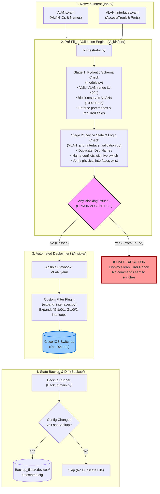

# Netopsforge

**Netopsforge** is an automated NetDevOps pipeline designed to safely manage Cisco switch configurations (VLANs, access ports, and trunks).

Instead of applying changes directly to network devices and hoping nothing breaks, Netopsforge enforces a **"Validate First, Deploy Second, Archive Third"** workflow:
1. **Define Intent:** Network engineers define VLANs and port assignments in simple YAML files.
2. **Pre-flight Validation:** Python and Pydantic inspect the definitions for syntax errors, reserved VLANs, duplicates, and device mismatches *before* touching real hardware.
3. **Ansible Deployment:** If (and only if) validation passes, Ansible pushes the configurations to the switches.
4. **Automated Backup & Diff:** Netmiko collects running configurations, checks if anything changed, and archives timestamped backups.

---

## Architecture & End-to-End Workflow



---

## Repository Structure

```text
Netopsforge/
├── Input/                          # Human-written network intent
│   ├── VLAN/                       # Active deployment inputs
│   │   ├── VLANs.yaml              # VLAN definitions (ID and name per device)
│   │   └── VLAN_interfaces.yaml    # Switchport assignments (access/trunk/descriptions)
│   └── test_inventories/           # Test suites (with known issues vs resolved)
│
├── Validation/                     # Pre-flight guardrails engine
│   ├── orchestrator.py             # Main entry point: runs all checks & triggers Ansible
│   ├── models.py                   # Pydantic data models & strict syntax validators
│   ├── VLAN_and_Interface_validation.py  # Network business logic & collision checks
│   ├── device_state_parser.py      # Normalizes switch state data for quick lookups
│   ├── validator.py                # Live device state collector (via Netmiko)
│   └── exception.py                # Custom exceptions (e.g., ReservedVLANError)
│
├── Ansible/                        # Deployment engine
│   ├── Inventory/
│   │   └── Inventory.yaml          # Host inventory (IPs, credentials, groups)
│   ├── Playbook/
│   │   └── VLAN.yaml               # Playbook to apply VLANs and interface configs
│   ├── filter_plugins/
│   │   └── expand_interfaces.py    # Custom filter expanding comma-separated port lists
│   └── ansible.cfg                 # Ansible configuration
│
├── Backup/                         # Configuration collector
│   └── main.py                     # Connects via SSH, diffs running-config, saves backups
│
├── Backup_files/                   # Timestamped archive of device configs
│   └── R1/                         # e.g., 20-08-2026_10-51-39.cfg
│
└── requirements.txt                # Python package dependencies
```

---

## How Each Component Works

### 1. `Input/` — Declaring What You Want
All network changes start here. Instead of writing raw Cisco IOS CLI commands, you define your intent cleanly in YAML.

* **`VLANs.yaml`**: Lists the VLAN IDs and names for each switch.
* **`VLAN_interfaces.yaml`**: Defines which switchports belong to which VLAN, whether they are `access` or `trunk`, native VLANs, and descriptions. It supports comma-separated interface lists like `"Gi1/0/1, Gi1/0/2"`.

---

### 2. `Validation/` — The Safety Net
Before touching a production switch, the validation engine runs two strict inspection stages:

* **Stage 1 (Schema & Type Safety - `models.py`)**:
  * Built using **Pydantic**.
  * Enforces valid 802.1Q VLAN ranges (`1 - 4094`).
  * Explicitly forbids Cisco legacy reserved VLANs (`1002 - 1005`).
  * Enforces mode rules: access ports cannot have `allowed_vlans` or `native_vlan`; trunk ports require `allowed_vlans` and a `native_vlan`.
* **Stage 2 (Business Logic & Hardware Checks - `VLAN_and_Interface_validation.py`)**:
  * Catches duplicate VLAN IDs or duplicate names within the same device.
  * Checks for naming collisions against existing live VLANs on the switch.
  * Ensures the interfaces you defined actually exist physically on the target device.
  * Checks that any VLAN assigned to an access or trunk port is actually declared.
* **The Coordinator (`orchestrator.py`)**:
  * Runs both stages and prints a color-coded summary report (`ERROR`, `CONFLICT`, `WARNING`, `CHANGE`, `OK`).
  * If any `ERROR` or `CONFLICT` exists, **it immediately aborts with an exit code of 1**, ensuring no bad configurations reach Ansible.

---

### 3. `Ansible/` — Safe Deployment
Once the validation engine approves the YAML inputs, Ansible takes over:

* **Built-in Pre-Task Safeguard**: The playbook [`VLAN.yaml`](file:///home/logee/Netopsforge/Ansible/Playbook/VLAN.yaml) has a pre-task that calls `orchestrator.py --dry-run`. Even if someone runs `ansible-playbook` directly without using the orchestrator, Ansible still runs validation first and aborts if errors are found.
* **Smart Interface Expansion (`filter_plugins/expand_interfaces.py`)**: A custom Ansible filter that automatically parses `"Gi1/0/1, Gi1/0/2"` into separate loop items so you don't have to repeat configuration blocks for consecutive interfaces.
* **Official Cisco IOS Modules**: Uses `cisco.ios.ios_vlans`, `cisco.ios.ios_l2_interfaces`, and `cisco.ios.ios_interfaces` in `merged` state to safely idempotently apply changes.

---

### 4. `Backup/` — Intelligent Config Archiving
Once changes are made, [`Backup/main.py`](file:///home/logee/Netopsforge/Backup/main.py) manages backups:

* Reads device credentials and IP addresses dynamically from `Ansible/Inventory/Inventory.yaml`.
* Connects to devices via SSH using **Netmiko** and retrieves `show running-config`.
* Uses Python's `difflib` to compare the live config against the most recent saved backup.
* **Zero Duplication**: If nothing changed on the switch, it notifies you and skips creating a duplicate file. If changes are detected, it prints the unified diff and saves a new file stamped with `DD-MM-YYYY_HH-MM-SS.cfg` under `Backup_files/<hostname>/`.

---

## Quick Start & Usage

### 1. Prerequisites
Ensure Python 3.10+ and Ansible are installed. Clone the repository and install the dependencies:

```bash
# Optional: create and activate a virtual environment
python3 -m venv .venv
source .venv/bin/activate

# Install required libraries
pip install -r requirements.txt
```

### 2. Run a Pre-Flight Dry Run (Simulation)
Test your input YAMLs against the validation engine without applying any changes:

```bash
# Validate default inventory files in Input/VLAN/
python3 Validation/orchestrator.py --dry-run

# Or test a specific directory (e.g. test inventories)
python3 Validation/orchestrator.py --dry-run --vlan-dir Input/test_inventories/with_issues
```

If issues are found, the script will output a clean report explaining exactly which switch, interface, or VLAN needs fixing.

### 3. Deploy Configurations
When you are ready to push configurations to the switches:

```bash
# Run via the orchestrator (validates first, then deploys if clean)
python3 Validation/orchestrator.py

# Or run directly with Ansible (the playbook will run pre-flight validation automatically)
ansible-playbook -i Ansible/Inventory/Inventory.yaml Ansible/Playbook/VLAN.yaml
```

### 4. Back Up Switch Configurations
Collect and archive the latest device states:

```bash
python3 Backup/main.py
```

---

## Authors & Contribution
Maintained as part of the **Netopsforge** automation framework. Contributions, test cases, and enhancements to validation rules are welcome.

