# Netopsforge

**Netopsforge** is an automated NetDevOps pipeline designed to safely manage Cisco switch configurations (VLANs, access ports, and trunks).

Instead of applying changes directly to network devices and hoping nothing breaks, Netopsforge enforces a **"Validate First, Deploy Second, Archive Third"** workflow:
1. **Define Intent:** Network engineers define VLANs and port assignments in simple YAML files.
2. **Pre-flight Validation:** Python and Pydantic inspect the definitions for syntax errors, reserved VLANs, duplicates, and device mismatches *before* touching real hardware.
3. **Ansible Deployment:** If (and only if) validation passes, Ansible pushes the configurations to the switches.
4. **Automated Backup & Diff:** Netmiko collects running configurations, checks if anything changed, and archives timestamped backups.

---

## Architecture & End-to-End Workflow

```mermaid
flowchart TD
    subgraph S1["1. Network Intent (Input/VLAN/)"]
        YAML1["VLANs.yaml<br/>(VLAN IDs & Names)"]
        YAML2["VLAN_interfaces.yaml<br/>(Access/Trunk & Ports)"]
    end

    subgraph S2["2. Dynamic Discovery & State Ingestion (Ansible Pre-Tasks)"]
        DISCO["Play 1: Intent Switch Discovery<br/>(OR logic: VLANs + Interfaces)"]
        FILTER["Inventory Filter<br/>Target declared active switches only"]
        STATE["Play 2: Live State Discovery (SSH)<br/>• show vlan brief<br/>• show ip interface brief<br/>• show interfaces switchport"]
        JSON["Save device_states/&lt;host&gt;.json"]

        YAML1 & YAML2 --> DISCO --> FILTER --> STATE --> JSON
    end

    subgraph S3["3. Pre-Flight Validation Engine (Validation/)"]
        ORCH["orchestrator.py"]
        P1["Stage 1: Pydantic Schema Check<br/>(models.py)<br/>• Valid VLAN range (1-4094)<br/>• Block reserved VLANs (1002-1005)<br/>• Enforce port modes & required fields"]
        P2["Stage 2: Device State & Logic Check<br/>(VLAN_and_Interface_validation.py)<br/>• Duplicate IDs / Names<br/>• Name conflicts with live switch<br/>• Verify physical interfaces exist"]
        DECISION{"Any Blocking Issues?<br/>(ERROR or CONFLICT)"}

        JSON --> ORCH
        YAML1 & YAML2 --> ORCH
        ORCH --> P1 --> P2 --> DECISION
    end

    subgraph S4["4. Automated Idempotent Deployment (Ansible/)"]
        PLAYBOOK["Ansible Playbook: VLAN.yaml<br/>(Targets active_switches)"]
        CANONICAL["Custom Filter (expand_interfaces.py)<br/>• Expands port lists 'Et0/1, Et0/2'<br/>• Canonicalizes names 'Et0/0' → 'Ethernet0/0'"]
        SWITCHES[("Cisco IOS Switches<br/>(SW1, SW2, etc.)")]

        DECISION -- "No (Passed)" --> PLAYBOOK
        PLAYBOOK --> CANONICAL --> SWITCHES
    end

    subgraph S5["5. State Backup & Diff (Backup/)"]
        BACKUP["Backup Runner (Backup/main.py)"]
        DIFF{"Config Changed<br/>vs Last Backup?"}
        ARCHIVE[("Backup_files/&lt;device&gt;/<br/>timestamp.cfg")]
        SKIP["Skip (No Duplicate File)"]

        SWITCHES --> BACKUP --> DIFF
        DIFF -- "Yes" --> ARCHIVE
        DIFF -- "No" --> SKIP
    end

    DECISION -- "Yes (Errors Found)" --> ABORT["HALT EXECUTION<br/>Display Clean Error Report<br/>No commands sent to switches"]

    classDef bwBox fill:#ffffff,stroke:#000000,stroke-width:1.5px,color:#000000
    classDef bwDecision fill:#f5f5f5,stroke:#000000,stroke-width:2px,color:#000000
    classDef bwHalt fill:#000000,stroke:#000000,stroke-width:2px,color:#ffffff
    classDef bwDevice fill:#f0f0f0,stroke:#000000,stroke-width:2px,color:#000000

    class YAML1,YAML2,DISCO,FILTER,STATE,JSON,ORCH,P1,P2,PLAYBOOK,CANONICAL,BACKUP,SKIP,ARCHIVE bwBox
    class DECISION,DIFF bwDecision
    class ABORT bwHalt
    class SWITCHES bwDevice
```



---

## Repository Structure

```text
Netopsforge/
├── Input/                          # Human-written network intent
│   ├── VLAN/                       # Active deployment inputs
│   │   ├── VLANs.yaml              # VLAN definitions (ID and name per device)
│   │   └── VLAN_interfaces.yaml    # Switchport assignments (access/trunk/descriptions)
│   └── test_inventories/           # Test suites
│       ├── with_issues/            # Intent files containing known errors for testing
│       └── resolved/               # Valid intent files for testing passing runs
│
├── Validation/                     # Pre-flight guardrails engine
│   ├── orchestrator.py             # Main CLI entry point: validates intent & runs playbook
│   ├── models.py                   # Pydantic data models & strict syntax validators
│   ├── VLAN_and_Interface_validation.py  # Network business logic & collision checks
│   ├── device_state_parser.py      # Normalizes switch state data from Ansible artifacts
│   ├── device_states/              # Cached live switch state artifacts (<host>.json)
│   └── exception.py                # Custom exceptions (e.g., ReservedVLANError)
│
├── Ansible/                        # Deployment engine
│   ├── Inventory/
│   │   ├── Inventory.yaml          # Host inventory (IPs, credentials, groups)
│   │   ├── group_vars/all.yaml     # Global variables (Python interpreter, become settings)
│   │   └── host_vars/              # Per-switch/router variables (SW1.yaml, SW2.yaml)
│   ├── Playbook/
│   │   └── VLAN.yaml               # Playbook to discover, validate, and deploy
│   ├── filter_plugins/
│   │   └── expand_interfaces.py    # Expands port ranges and canonicalizes names
│   └── ansible.cfg                 # Ansible controller configuration
│
├── Backup/                         # Configuration backup & diff engine
│   ├── main.py                     # Connects via SSH, diffs running-config, saves backups
│   └── README.md                   # Documentation for the backup engine
│
├── Backup_files/                   # Timestamped archive of device configs
│   └── R1/                         # e.g., 20-08-2026_10-51-39.cfg
│
├── requirements.txt                # Python package dependencies
└── README.md                       # Main project documentation
```

---

## Key Features & How It Works

### 1. Dynamic Switch Targeting (OR Logic)
Ansible does not blindly apply configurations to all inventory hosts.
* **Play 1** scans the intent files (`VLANs.yaml` and `VLAN_interfaces.yaml`).
* Any switch declared in **either** file (OR logic) is dynamically added to the `active_switches` group.
* Switches present in inventory but omitted from the input files (e.g. `SW2`) are automatically bypassed.

### 2. Live Operational State Ingestion
* Before applying changes, Ansible executes `cli_parse` with `ntc-templates` over SSH to gather:
  * `show vlan brief`
  * `show ip interface brief`
  * `show interfaces switchport`
* States are written to `Validation/device_states/<hostname>.json` on localhost.
* `Validation/device_state_parser.py` loads these live states so the validation engine inspects real switch status.

### 3. Pre-Flight Validation Safety Net
Before touching a production switch, [Validation/orchestrator.py](file:///home/logee/Netopsforge/Validation/orchestrator.py) executes two inspection stages:
* **Stage 1 (Schema & Type Safety - `models.py`)**:
  * Built using **Pydantic**.
  * Enforces valid 802.1Q VLAN ranges (`1 - 4094`).
  * Explicitly forbids Cisco legacy reserved VLANs (`1002 - 1005`).
  * Enforces mode rules: access ports cannot have `allowed_vlans` or `native_vlan`; trunk ports require `allowed_vlans` and a `native_vlan`.
* **Stage 2 (Business Logic & Hardware Checks - `VLAN_and_Interface_validation.py`)**:
  * Catches duplicate VLAN IDs or duplicate names on the same device.
  * Checks for naming collisions against existing live VLANs on the switch.
  * Ensures the interfaces you defined actually exist physically on the target device.
  * Checks that any VLAN assigned to an access or trunk port is declared.
* **The Decision**:
  * If any `ERROR` or `CONFLICT` is detected, **execution immediately halts with exit code 1**. No commands reach the switches.

### 4. True Idempotency (`changed=0`) & Interface Canonicalization
* In Cisco IOS, running configurations display full canonical interface names (e.g. `Ethernet0/0`), whereas engineers often write abbreviated names (e.g. `Et0/0`).
* The custom filter [Ansible/filter_plugins/expand_interfaces.py](file:///home/logee/Netopsforge/Ansible/filter_plugins/expand_interfaces.py) automatically expands comma-separated interfaces and canonicalizes names:
  * `Et0/0` $\rightarrow$ `Ethernet0/0`
  * `Gi1/0/1` $\rightarrow$ `GigabitEthernet1/0/1`
  * `Fa0/1` $\rightarrow$ `FastEthernet0/1`
* Because names match Cisco's internal state exactly, subsequent runs result in **`changed=0`** (true idempotency).
* Multi-encapsulation switchports include `trunk.encapsulation: dot1q` to prevent Cisco rejection when encapsulation defaults to `Auto`.

### 5. Isolated Intent File Loading
* Play 2 explicitly includes target files (`file: "{{ target_vlan_file }}"` and `file: "{{ target_iface_file }}"`).
* This eliminates variable overwrite collisions from other YAML files in the input folder.

### 6. Automated Configuration Archiving & Diff
[Backup/main.py](file:///home/logee/Netopsforge/Backup/main.py) automates change tracking:
* Connects to devices via SSH using **Netmiko** and retrieves `show running-config`.
* Uses Python's `difflib` to compare the live config against the most recent saved backup.
* **Zero Duplication**: If nothing changed on the switch, it notifies you and skips creating a duplicate file. If changes are detected, it prints the unified diff and saves a new file stamped with `DD-MM-YYYY_HH-MM-SS.cfg` under `Backup_files/<hostname>/`.

---

## Quick Start & Usage

### 1. Prerequisites
Ensure Python 3.10+ and Ansible are installed. Clone the repository and install the dependencies into a virtual environment:

```bash
# Create and activate virtual environment
python3 -m venv .venv
source .venv/bin/activate

# Install required packages
pip install -r requirements.txt
```

### 2. Pre-Flight Dry Run (Simulation)
Test your input YAMLs against the validation engine without modifying any switch:

```bash
# Validate default intent files (Input/VLAN/VLANs.yaml & VLAN_interfaces.yaml)
python3 Validation/orchestrator.py --dry-run

# Test a custom test directory
python3 Validation/orchestrator.py --dry-run --vlan-dir Input/test_inventories/with_issues

# Test specific custom files
python3 Validation/orchestrator.py --dry-run -v Input/VLAN/VLANs.yaml -i Input/VLAN/VLAN_interfaces.yaml
```

If issues are found, the report clearly highlights the problem:
```text
================================================================================
 VALIDATION REPORT (VLANS.YAML, VLAN_INTERFACES.YAML) 
================================================================================
Summary of Severities: {'OK': 6}
Has Blocking Issues (ERROR / CONFLICT): False
--------------------------------------------------------------------------------

>>> [OK] Count: 6
  1. [SW1] VLAN: VLAN 10 (Devops) is already present on device SW1 and name matches. No need to create.
  2. [SW1] VLAN: VLAN 20 (Security) is already present on device SW1 and name matches. No need to create.
  3. [SW1] VLAN: VLAN 30 (Netops) is already present on device SW1 and name matches. No need to create.
  4. [SW1] Interface VLAN: Interface Et0/0 is already in access VLAN 10 on device SW1
  5. [SW1] Interface VLAN: Interface Et0/1 is already in access VLAN 20 on device SW1
  6. [SW1] Trunk Interface: Trunk interface Et0/2 is already properly configured on device SW1
```

### 3. Deploy Configurations
When ready to push configurations to the switches:

```bash
# Standard deployment (runs validation first, then deploys via Ansible if clean)
python3 Validation/orchestrator.py

# Pass custom intent files
python3 Validation/orchestrator.py -v Input/VLAN/VLANs.yaml -i Input/VLAN/VLAN_interfaces.yaml

# Direct Ansible invocation (built-in pre-task automatically runs validation dry-run first)
ansible-playbook -i Ansible/Inventory/Inventory.yaml Ansible/Playbook/VLAN.yaml
```

### 4. Back Up Configurations & Review Diffs
Collect and archive running configurations:

```bash
python3 Backup/main.py
```

---

## Command-Line Arguments Reference

| Flag | Long Option | Description | Default |
| :--- | :--- | :--- | :--- |
| `-v` | `--vlan-file` | Path to VLANs intent YAML file | `Input/VLAN/VLANs.yaml` |
| `-i` | `--interface-file` | Path to VLAN interfaces intent YAML file | `Input/VLAN/VLAN_interfaces.yaml` |
| | `--vlan-dir` | Path to directory containing intent files | None |
| `-d` | `--dry-run` | Run pre-flight validation only without applying changes | False |

---

## Authors & Contribution
Maintained as part of the **Netopsforge** automation framework. Contributions, test cases, and enhancements to validation rules are welcome.
